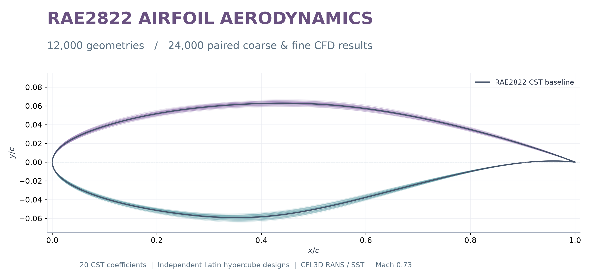

# RAE2822 Surrogate Benchmark

**Reproducible MLP and Kriging experiments for aerodynamic prediction from 20 CST coefficients.**



This project studies how predictive accuracy changes with training-set size in a transonic airfoil design space. It includes MLP architecture screening, exact isotropic Matérn-5/2 Kriging, paired learning curves, test-error diagnostics, and model inference. Both models predict lift and drag coefficients; lift-to-drag ratio is computed from the two outputs.

| Resource | Location |
|---|---|
| Public data, methodology and Dataset Viewer | [Hugging Face dataset](https://huggingface.co/datasets/ShuangheYang/rae2822-cst20-cfl3d-fine) |
| Trained MLP models | [MLP repository](https://huggingface.co/ShuangheYang/rae2822-cst20-mlp-r05) |
| Trained Kriging models | [Kriging repository](https://huggingface.co/ShuangheYang/rae2822-cst20-kriging-r05) |
| Illustrated research report | [PDF](https://huggingface.co/datasets/ShuangheYang/rae2822-cst20-cfl3d-fine/resolve/61bcbdd80989bca9260acba5c99b8fd0293200ee/research/report/R05_MLP_Kriging_report.pdf) |
| Live prediction and interactive explorer | [Open website](https://shuangheyang.github.io/rae2822-surrogate-benchmark/#predict) |
| Methods and interpretation | [METHODS.md](METHODS.md) |

The benchmark uses the **fine** labels. The dataset also provides paired coarse results for multi-fidelity research. Neither the CFD-generation platform nor solver executables are included. Training and inference require no CFD installation.

## Install

Python 3.10 or later is required. A separate environment keeps the benchmark independent of CFD software:

```bash
conda env create -f environment.yml
conda activate airfoil_surrogate
```

Alternatively, in an existing Python environment:

```bash
python -m pip install -r requirements.txt
```

CPU is supported. For GPU execution, install a PyTorch build compatible with your CUDA driver using [the PyTorch installer](https://pytorch.org/get-started/locally/). Do not copy CUDA package versions from another machine without checking compatibility. Exact Kriging requires dense float64 linear algebra and several GiB of memory at 10,000 points; CPU operation can be slow.

## Predict with a published model

Run commands from the repository root:

```bash
python run.py models
python run.py --device cpu predict --family mlp --input configs/example_input.json
python run.py --device cpu predict --family kriging --input configs/example_input.json
```

`models` downloads only the two representative checkpoints. Downloads are anonymous, pinned to immutable Hugging Face commits and checked against SHA-256 hashes. No account, token or paid service is needed.

Input JSON accepts a single array of 20 coefficients, a batch of such arrays, or `{"cst": [...]}`. The order is **U0–U9, L0–L9**. Output columns are `CL`, `CD`, `L_D`. Coefficients outside the published design box trigger an extrapolation warning. This Python command accepts CST coefficients; use the browser interface below to normalize and fit coordinate files.

To use a newly trained model, pass its NPZ path with `--model`. Model files use pickle-free NumPy serialization.

## Inspect the published study without training

```bash
python run.py --run-dir runs/reference reference
python run.py --run-dir runs/reference figures
python run.py --run-dir runs/reference export
```

This downloads the frozen input arrays, predictions, metrics, screening records and the original experiment workbook. It regenerates the scientific figures and exports `runs/reference/results/benchmark_results.xlsx`. The original 17-sheet workbook remains available separately. `REFERENCE_ONLY` prevents training over these published records.

Optional numerical verification of both representative models on all 1,500 test cases:

```bash
python run.py --run-dir runs/reference models
python run.py --run-dir runs/reference --device cpu verify
```

## Reproduce training in a fresh directory

These commands **start real training**. They are separate from the commands above.

```bash
python run.py --run-dir runs/reproduction prepare
python run.py --run-dir runs/reproduction plan
python run.py --run-dir runs/reproduction --device auto mlp-select
python run.py --run-dir runs/reproduction --device auto mlp-curves
python run.py --run-dir runs/reproduction --device auto kriging
python run.py --run-dir runs/reproduction --device auto evaluate
python run.py --run-dir runs/reproduction figures
python run.py --run-dir runs/reproduction export
```

1. `prepare` verifies the frozen 10,000 training, 500 validation and 1,500 test records. Training and validation share no identical CST vectors with the test partition. IDs are local to each LHS pool; use the pool prefix to identify a geometry.
2. `plan` shows the Kriging run schedule without training.
3. `mlp-select` screens 12 configurations with seed 11, confirms the best three with seeds 22 and 33, and selects by validation score. It does not read final test labels.
4. `mlp-curves` trains the selected configuration at eight budgets for all three seeds.
5. `kriging` fits exact isotropic models on the same training subsets. Hyperparameters use training marginal likelihood, with recorded optimizer diagnostics and one predefined likelihood-driven bound expansion. No sparse approximation is substituted.
6. `evaluate` freezes and verifies the trained model list before reading test labels. It records metrics, paired bootstrap intervals, error associations, sensitivity and warm inference timing.
7. `figures` and `export` use those evaluation records; they do not refit models.

All outputs stay inside `--run-dir`. Completed fits are checked and skipped on restart. Interrupted fits restart from their beginning; there is no epoch-level checkpoint resume. Changed inputs, code or configurations require a new run directory. Use `Ctrl+C` to interrupt; for Kriging, a file named `STOP_KRIGING` or `STOP_RESEARCH` inside the run directory also requests a stop. Remove it before resuming.

For a partial Kriging run, append `--max-budget 500 --seeds 11`; completion of the full frozen schedule is required for the unified evaluation. Hyperparameter experiments should use separate run directories and remain validation-driven.

## Numerical checks

```bash
python run.py --device cpu smoke
python src/test_kriging_engine.py
```

These checks use small synthetic arrays, not CFD training data. They cover CPU optimization, scaling, serialization, resume guards, GP mean/variance and marginal likelihood against scikit-learn, analytic kernel gradients, and CPU/GPU agreement when CUDA is available. GitHub Actions runs the CPU checks and the browser numerical checks (`node tests/browser_core.mjs`, Node.js 24).

See [VALIDATION.md](VALIDATION.md) for the release checks and their limits.

## Interactive presentation

The [website](https://shuangheyang.github.io/rae2822-surrogate-benchmark/#predict) provides **new predictions directly in your browser**, alongside the saved-case explorer and learning curves. No installation, account, API token or paid inference service is needed. Input values and coordinate files stay in the browser. Only static model files are downloaded; no geometry is sent to a prediction server. The site uses no analytics or external JavaScript libraries.

1. In **Predict**, choose **20 CST coefficients** or **Airfoil coordinates**.
2. Paste 20 signed values in U0–U9, L0–L9 order, or paste/load a coordinate text file. The baseline examples and **Use selected test case** button provide working inputs.
3. For coordinates, choose chord normalization. Use the default only for an unrotated, horizontally aligned airfoil; for rotated data, select manual leading/trailing-edge coordinates.
4. Click **Predict aerodynamic coefficients** or **Fit CST & predict**. MLP returns CL, CD and their ratio. Check **Also compare Kriging** to compute the second model's prediction.
5. Inspect the geometry, coordinate-fit errors and domain status. Download a JSON record if desired. Editing the input clears the previous result.

Supported coordinate layouts are an ordered two-column contour (`x y`, Selig style), Lednicer upper/lower blocks with point counts, and three columns `x y_upper y_lower`. Lower ordinates must carry their negative signs where applicable. An optional airfoil-name header, comments, scientific notation and comma-separated numeric fields are accepted. At least 30 distinct x positions per surface are required. This is coordinate input, not image recognition.

Normalization uses one chord length for **both axes**, preserving thickness and camber. Coordinates must cover both surfaces and have a closed leading and trailing edge. The fit uses the same degree-9 CST definition as training, with unconstrained least squares; coefficients are never clipped to the training box. The interface rejects fits with surface RMSE above 0.0005 chord or maximum point deviation above 0.002 chord. These are engineering screening thresholds, not aerodynamic accuracy guarantees. A good geometry fit can still lie outside the learned RAE2822 neighborhood. Such predictions require explicitly enabling **out-of-domain exploration** and remain unvalidated.

The models represent the **fine CFL3D condition: Mach 0.73, Reynolds number 6,500,000, angle of attack 2.79 degrees**. They do not accept a new operating condition or run CFD. New input has no reference CFD label, so the live panel reports predictions and fitting diagnostics, not an actual prediction error. The separate saved-case explorer compares stored predictions with known CFD labels.

Browser inference uses the original unquantized float64 weights: approximately 79 KB for MLP and an optional 1.76 MB for exact Kriging with all 10,000 training centers. A Web Worker performs fitting and inference. The browser downloads and verifies each model's SHA-256 before use. The browser implementation was compared against all 1,500 released test predictions; see [VALIDATION.md](VALIDATION.md).

Preview locally:

```bash
python -m http.server 8000 --directory docs
```

Open `http://localhost:8000/#predict` in a current browser; do not double-click the HTML as a `file://` document. The public deployment uses free GitHub Pages. Training still runs locally in Python; the website computes inference in the visitor's browser. See [PUBLISHING.md](PUBLISHING.md) for deployment and model export.

## Repository map

| File or directory | Purpose |
|---|---|
| `run.py` | Unified command entry point; experiment directory and device selection |
| `configs/protocol.json` | Twelve MLP configurations, splits, budgets and selection rules |
| `configs/assets.lock.json` | Public artifact URLs, immutable revisions and hashes |
| `configs/cst_bounds.json` | Feature order, baseline coefficients and input bounds |
| `download_assets.py` | Verified public downloads and split validation |
| `src/mlp_engine.py` | MLP, AdamW/L-BFGS training, scaling and NPZ serialization |
| `src/kriging_engine.py` | Exact isotropic GP fitting, uncertainty and serialization |
| `run_mlp_study.py` | Screening, confirmation, learning curves and resumable records |
| `run_kriging_study.py` | Likelihood fitting, warm starts, bounds and diagnostics |
| `evaluate_study.py` | Frozen test evaluation, metrics, bootstrap and timing |
| `make_figures.py`, `plot_relative_error_learning.py` | Scientific plots, including separate CL/CD relative errors |
| `predict.py`, `verify_pretrained.py` | Inference and released-prediction verification |
| `export_results.py` | Excel metrics, learning curves and case-level predictions |
| `build_explorer.py` | Generate the browser data payload from frozen evidence |
| `export_browser_models.py` | Export the pinned trained checkpoints to float64 browser assets |
| `src/test_kriging_engine.py`, `tests/smoke.py` | Numerical and portability checks |
| `tests/browser_core.mjs` | All-test-case inference parity and coordinate-fitting checks |
| `docs/inference-core.mjs`, `docs/geometry-core.mjs` | Browser model equations, coordinate parsing, normalization and CST fitting |
| `docs/inference-worker.mjs`, `docs/predict-ui.mjs` | Background computation, input handling and prediction display |
| `docs/assets/inference/` | Model manifest, source hashes and unquantized browser weights |
| `docs/` | Interactive prediction website, saved explorer and figures |
| `runs/` | Local downloaded/generated files; excluded from Git |

## Evidence and scope

The published experiment shows lower MLP error at 5,000 and 10,000 training samples, while this Kriging pipeline performs better at the smaller measured budgets. The mean curves change order between 2,000 and 5,000 samples. That interval is an observation for this design domain and protocol, not a universal crossover threshold or a comparison with every form of Kriging.

All budgets use 500 extra validation labels. MLP configurations were selected at the full budget, not independently optimized at every smaller budget. The independent LHS evaluation pool was used in earlier research; it is not a historically blind test. Predictions approximate the recorded CFL3D solutions at the fixed flow condition; they are not wind-tunnel measurements or evidence of out-of-domain accuracy.

## License and citation

Repository code is licensed under [MIT](LICENSE). Data, trained weights and downloaded research artifacts are governed by their source Hugging Face repositories. The browser model files in `docs/assets/inference/` are unquantized exports of those published weights, with source revisions and hashes recorded in the manifest; their source terms still apply. This code license does not relabel those assets or grant rights to the private CFD platform.

Use [CITATION.cff](CITATION.cff) to cite this software, and cite the data/model repository revision used in your experiment. Source mappings and adaptation notes are recorded in [PROVENANCE.json](PROVENANCE.json).
